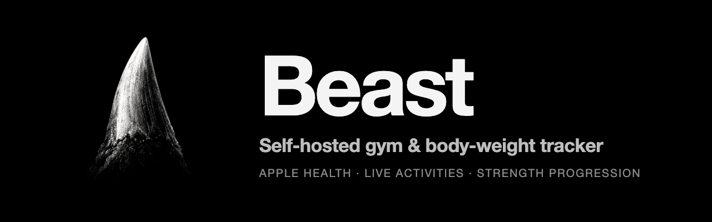

<div align="center">



**A self-hosted gym and body-weight tracker you actually own.**

Plan your week, run guided workouts, log every set and your body weight —<br>
on your phone, synced across your devices, behind your own passkey login.

[](LICENSE)

[Self-hosting guide](docs/SELF_HOSTING.md) ·
[Mobile builds](docs/MOBILE.md) ·
[Roadmap](ROADMAP.md) ·
[Changelog](CHANGELOG.md)

</div>

> **Beast is a fork of [openGym](https://github.com/DuarteSantos8/openGym)** by Duarte Santos
> (AGPL-3.0-or-later). The upstream project, its demo and its community live there.
> This fork keeps the same license and adds the iOS-native and training features below.

## What Beast adds on top of openGym

**iOS native**

- **Apple Health sync:** finished workouts are saved to Apple Health through a local Capacitor plugin.
- **Live Activity:** the running workout sits on the lock screen. Tick the next set and adjust
  each kind of set without opening the app.

**Training**

- **Strength progression:** rep records and percentages, RPE-based progression, strength level.
- **Top set + back-off:** the first work set decides progression and the rest follow it at a percentage.
- **Live comparison** with the last time you did the exercise, a record flash, smart rest and
  "same as previous" set.
- **Cardio by sport** with distance exercises and a weekly cardio goal.
- **Goals card** on the home screen: sessions, cardio, lift and time goals besides body weight.

## Why Beast

Most workout apps keep your data on their servers, push you towards a subscription, or vanish when
the company does. Beast runs on your own box, keeps your data in a folder you control, and is yours
to fork. No account on someone else's server, no subscription, no ads, no telemetry.

Two things set it apart from a plain self-hosted tracker: it is **native on iOS** where it matters
(the lock screen, Apple Health), and it takes **strength progression** seriously instead of just
logging numbers.

## What Beast adds

### On your iPhone

| Feature | What it does |
|---|---|
| **Live Activity** | While a workout runs, the lock screen and Dynamic Island name the next set (`Bench Press — Set 3/4 · 60 kg × 8`) and count the rest down. The countdown is drawn by iOS from an absolute end time, so it keeps ticking with the app in the background. |
| **Tick sets from the lock screen** | With the app asleep, adjust the weight and reps with − / + and press **Done**. It saves the set, starts the rest it earns and shows the next one. Handles loaded lifts, bodyweight, holds, cardio and each side of a per-side set. iOS 17+. |
| **Apple Health** | Each finished workout is written to Apple Health as a strength-training workout, so Bevel, Fitness and other apps that read Health count it. Write-only: Beast reads nothing back. |

### In the gym

- **Top set + back-off.** The first work set decides the progression and the remaining sets follow
  it at a percentage you choose, recalculated whenever the top set changes.
- **Strength records and levels.** Rep records (1 / 3 / 5 / 8 / 10), a percent-of-1RM table on each
  exercise, and a card placing your main lifts on a beginner-to-beast scale from your latest weigh-in.
- **Effort-aware progression.** A progression rule that follows the effort you rated (RPE / RIR).
- **Live comparison.** Every done set shows how it moved against the same set last time
  (`+2.5 kg`, `+1 rep`, `=`), a heavier set than your history flashes a record, and an optional
  **Smart rest** scales the rest by reps and effort. A "same as previous" option copies the last set.
- **Cardio by sport.** Runs, rides, rows and swims log a distance with the pace of their sport,
  carries and sled work count metres, and 25 exercises the dataset lacked were added (swimming
  strokes, rowing machine, cycling, landmine presses, sled, sandbag and kettlebell carries).
- **Goals on Home.** Sessions per week, weekly cardio minutes, 1RM targets per lift and a time for
  a distance (5 km under 30 min), next to the body-weight goal.
- **Thumbnail list view.** Exercise animations as small, optional thumbnails, opened one at a time.

Everything else (the planner, guided sessions, stats, sync, passkeys, imports, 17 languages) comes
from openGym and is listed below.

## Quick start

You need [Docker](https://docs.docker.com/get-docker/) with Compose.

```bash
git clone https://github.com/juansuarezdev/beast
cd beast
cp .env.example .env
docker compose up -d --build
```

> [!IMPORTANT]
> Use `--build`. The prebuilt images that `docker-compose.yml` names are openGym's, and they do not
> contain Beast's changes. Building locally is what gives you this fork. You don't need Node on the host.

Open <http://localhost:8080>, tap **Create profile**, and you're in. The first start downloads the
exercise media (about 140 MB) once.

To reach it from your phone with passkeys you need HTTPS on a domain; that's a two-line change in
`.env`. The [self-hosting guide](docs/SELF_HOSTING.md) walks through Cloudflare Tunnel, Caddy,
Traefik and nginx, and there are separate guides for
[HTTPS on a LAN](docs/SELF_HOSTING_HTTPS.md) and [Kubernetes](docs/SELF_HOSTING_KUBERNETES.md).

<details>
<summary><b>Configuration reference</b> (all through <code>.env</code>)</summary>

| Variable | What it does | Default |
|---|---|---|
| `RP_ID` | Hostname passkeys are bound to | `localhost` |
| `ORIGIN` | Full URL the app is served from | `http://localhost:8080` |
| `WEB_PORT` | Host port for the web UI | `8080` |
| `NGINX_PORT` | Port the web container listens on inside the container | `80` |
| `BACKEND` | Name of the API service that `/api` is proxied to | `api` |
| `PORT` | Port the API listens on; the web container proxies to the same value | `3000` |
| `RP_NAME` | Name shown in the passkey prompt | `Beast` |
| `SESSION_DAYS` | How long a sign-in lasts, in days | `90` |
| `ADMIN_UIDS` | User ids that get the admin dashboard, comma-separated | *(none)* |
| `INVITE_ONLY` | Require an invite code to create a profile | *(off)* |
| `ALLOW_GUEST` | Offer "Continue without account"; `0` requires a profile | *(on)* |
| `PASSWORD_LOGIN` | Offer name-and-password sign-in next to passkeys | *(off)* |
| `TRUST_PROXY` | Let the sign-in throttle read the client address from proxy headers | `1` in `docker-compose.yml` |
| `AUDIT_LOG` | Record sign-ins and admin actions; `0` records nothing | *(on)* |
| `AUDIT_MAX` | Events kept in the activity log; `0` for no limit | `5000` |
| `AUDIT_DAYS` | Days kept in the activity log; `0` keeps until `AUDIT_MAX` | `90` |
| `AUDIT_IP` | Record the caller's address: `off`, `net` (network only) or `full` | `off` |
| `VAPID_SUBJECT` | Contact URL sent with push notifications | your `ORIGIN` |
| `API_TARGET` | API image to build: `default`, or `coach` with the Claude Agent SDK and Codex CLI | `default` |
| `COACH_DISABLED` | `1` forces the AI coach off instance-wide | *(unset)* |

Push-notification keys are generated on first run into `./data/vapid.json`. `DATA_DIR` is pinned to
`/data` inside the container and mapped to `./data` on the host; change the volume, not the
variable. The [self-hosting guide](docs/SELF_HOSTING.md) covers every option in detail.

</details>

## iPhone app

Apple Health and the Live Activity only exist in the **native iOS app**, which you build onto your
own device with Xcode (the web app and the home-screen PWA don't have them).

1. `cd frontend && npm install && npm run build:mobile && npx cap open ios`
2. In Xcode, set your own **bundle ID and team** under *Signing & Capabilities* for both the `App`
   target and the `BeastLiveActivity` widget extension. The App target needs the **HealthKit** capability.
3. Choose your iPhone and press **Run**. Turn on *Settings → During a workout → Save workouts to
   Apple Health* inside the app.

A build signed with a free Apple ID expires after 7 days and has to be reinstalled. Requirements,
limits and the code layout are in [docs/MOBILE.md](docs/MOBILE.md).

## Everything inherited from openGym

### Features

**Planning**

- A routine per weekday over a library of **1,324 exercises** with animated demos, searchable and
  browsable by muscle on a body map. Filter by the equipment you own.
- Four starter plans (Push/Pull/Legs, Upper/Lower, Full Body, 5×5) that load as ordinary,
  editable routines.
- Move a session to another day without touching the weekly plan. The week starts on Monday or
  Sunday, your choice.
- Supersets, warm-up sets, drop sets and rest-pause, timed exercises (planks, hangs, carries),
  cardio by time and speed, rest time per exercise, planned deloads.
- Your own exercises, with your own photo, GIF or short video. Location data is stripped on the
  device before upload.

**Training**

- Guided sessions: today's workout starts itself, weights are pre-filled from last time, a rest
  timer runs between sets, PRs are detected as you go. On a rest day it tells you when the next
  session is.
- A quiet workout screen: one menu per exercise, the set number as the set's own menu, card or
  list view. Switches in Settings bring the old button rows back if you liked them.
- Optional effort column as RIR or RPE, colour-coded, with a plain-language line per level.
- Plate math for barbell, EZ bar, trap bar and Smith machine, worked out from the plates you own.
- Bodyweight exercises know they carry no load: log reps, add a dip belt if you use one.
- Per-side reps for lunges and single-arm work, the screen stays awake while you train, and a
  rest-timer alert can flash the screen for loud gyms.

**Progress**

- Progression rules per routine or per exercise: linear, Greyskull LP, double progression through a
  visible rep range, or adding time. Each target explains why it is that number; missed reps never
  add load, stalls trigger a deload.
- Estimated 1RM per exercise with its own curve, Structural Balance ratios (Poliquin, Thibaudeau,
  ATG), a year-long activity heatmap.
- A muscle map in three modes: where your volume went, what is still recovering, and what has gone
  untrained.
- Body-weight chart against a goal line.
- Edit any saved workout after the fact, log one you did on paper, or move it to the right date.
  Records are re-read from the corrected history.

**Accounts and data**

- Passkeys (Face ID, Touch ID, fingerprint) with per-profile data synced across devices. Password
  sign-in can be switched on per instance; new devices pair with a one-time code or QR.
- Two devices editing at once merge instead of overwriting each other (see [sync](#how-sync-works)).
- Import from FitNotes, Strong, Hevy (CSV or API key) and Apple Health weight exports. Export
  everything as one JSON file whenever you like.
- Share a plan as a small file or print it as a PDF.
- Optional admin dashboard with invite-only signup and an activity log.
- 17 languages, including right-to-left Arabic. Exercise names and instructions are translated
  for most of them.

**Optional extras, off by default**

- An [AI coach](docs/AI_COACH.md) that drafts a week of routines and later suggests changes based on
  what you logged. You approve every change. It runs on your server with your own provider key
  (Anthropic, OpenAI, Gemini or any OpenAI-compatible endpoint, Ollama included).
- An [MCP server](mcp/README.md) so an assistant like Claude Desktop can answer questions about your
  training history. Read-only and local; not part of the Docker build.

The full list of what changed release by release is in the [changelog](CHANGELOG.md).


## How it works

<p align="center">
<picture>
  <source media="(prefers-color-scheme: dark)" srcset="docs/diagrams/architecture-dark.png">
  
</picture>
</p>

- **`frontend/`** is React 19 and Vite (React Router, Zustand), built to static files inside Docker.
- **`api/`** is plain `node:http` with two dependencies: `@simplewebauthn/server` for passkeys and
  `web-push` for notifications. Everything is stored as JSON under `./data`.
- **`web/`** builds the frontend and serves it with nginx, proxying `/api` so the whole app sits on
  one origin, which passkeys require.

The training logic (progression rules, 1RM, how a logged session is read back) lives in pure
functions under `frontend/src/lib/` with tests beside them. The HTTP API is documented as an
OpenAPI spec in [`api/openapi.yaml`](api/openapi.yaml).

### How sync works

Each profile's data is one document with a server revision. A device sends the revision it last
saw along with its changes; if another device wrote in between, the server refuses and returns the
current document so the device can merge and retry.

<p align="center">
<picture>
  <source media="(prefers-color-scheme: dark)" srcset="docs/diagrams/sync-dark.png">
  
</picture>
</p>

Nothing that hasn't reached the server is discarded on disconnect or sign-out, and the app shows a
banner whenever it's working offline.

### Your data

Everything lives in `./data` on your host:

| File | Contents |
|---|---|
| `db.json` | Profiles and public passkey data |
| `state-<user>.json` | Each user's plan, workouts, body weight and settings |
| `audit.log` | Admin activity log (no IP addresses unless you turn that on) |
| `secret` | Session-cookie signing key |

Back up `./data` and you've backed up everything. Passkey private keys never reach the server; they
stay in your phone's secure hardware or your password manager.


## Documentation

The [documentation index](docs/README.md) sorts every guide by who it's for. The most used ones:

| I want to | Read |
|---|---|
| Get a quick answer | [FAQ](docs/FAQ.md) |
| Set up my own instance | [Self-hosting](docs/SELF_HOSTING.md) |
| Use the Android or iPhone app | [Phone app](docs/MOBILE.md) |
| Bring my history from another app | [Importing data](docs/DATA_IMPORTS.md) |
| Turn on the AI coach | [AI coach](docs/AI_COACH.md) |
| Contribute code | [Contributing](CONTRIBUTING.md) |
| Report a security problem | [Security](SECURITY.md) |


## License

**Beast's own code** is licensed under the [GNU AGPL v3.0](LICENSE). You can self-host, use,
modify and share it; if you run a modified version as a network service, you have to offer that
version's source under the same license.

> [!IMPORTANT]
> **The exercise media is not covered by that license.** Exercise metadata and instruction text come
> from [ExerciseDB v1](https://exercisedb.dev/) through
> [hasaneyldrm/exercises-dataset](https://github.com/hasaneyldrm/exercises-dataset) under MIT. The
> images and animations are third-party content under neither MIT nor the AGPL, and their ownership
> is disputed: the dataset attributes them to [Gym visual](https://gymvisual.com/), while
> [ExerciseDB/AscendAPI](https://exercisedb.io/faq) claims to own them. Beast doesn't redistribute
> them (your instance downloads them on first start) and doesn't relicense them. To reuse that
> media, clear it with the rights holder first.

Full third-party notices, including the body-diagram geometry, are in [NOTICE.md](NOTICE.md).


## Credits

Beast is a fork of [openGym](https://github.com/DuarteSantos8/openGym) by **Duarte Santos**, which
does the heavy lifting: the planner, the exercise library, sync, passkeys and the self-hosting
setup. Upstream's community, releases and demo live there. Beast keeps the same license
(AGPL-3.0-or-later) and its [notices](NOTICE.md).
